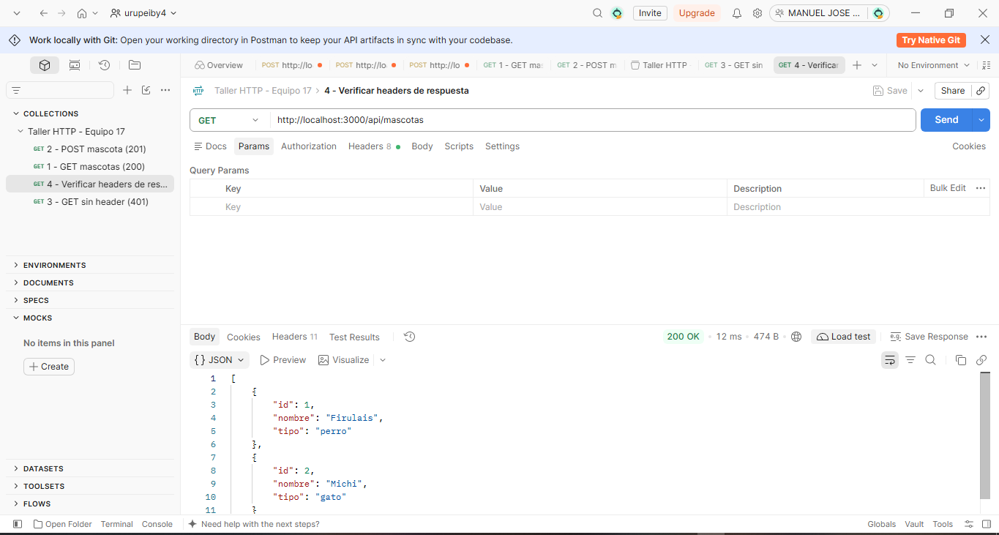
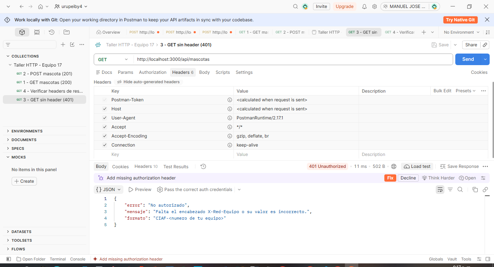

# Taller Final – Programación de Redes (CIAF)

## 1. Equipo

| No. de lista | Apellidos y nombres      |
| ------------ | ------------------------ |
| 17           | Parra Ladino Manuel Jose |

(Programación de redes, Grupo 2 miércoles.)

- **Valor de N:** 17
- **Encabezado de petición asignado:** `X-Red-Equipo: CIAF-17`
- **Encabezado de respuesta:** `X-Servidor-Procesado: Equipo-17`

## 2. Escenario de red: "El Club Secreto de las Mascotas"

Servicio web de **registro y consulta de mascotas** de una veterinaria.

**¿Quién consumiría este servicio?** Un **navegador web**: la página de la
veterinaria (servida en http://localhost:5500) pediría la lista de mascotas y
registraría mascotas nuevas. Postman hace de cliente en las pruebas.

**Riesgos si viajara por HTTP sin cifrado:**

- Alguien en la misma red Wi-Fi podría **leer** los datos y el valor de
  X-Red-Equipo (nuestra "contraseña") y usarla para entrar.
- Podría **modificar** lo que enviamos o recibimos sin que nos demos cuenta.
- Podría **hacerse pasar** por nuestro servidor, porque HTTP no comprueba quién es quién.

## 3. Cómo ejecutarlo

    npm install
    node server.js

El servidor queda en http://localhost:3000

## 4. Endpoints

| Método | Ruta          | Qué hace                                      | Respuesta   |
| ------ | ------------- | --------------------------------------------- | ----------- |
| GET    | /api/mascotas | Lista las mascotas                            | 200 OK      |
| POST   | /api/mascotas | Registra una mascota (JSON con nombre y tipo) | 201 Created |

Toda petición a /api debe llevar el encabezado `X-Red-Equipo: CIAF-17`.
Si falta o es incorrecto, el servidor responde **401 Unauthorized** con un JSON explicativo.
Las respuestas exitosas incluyen `X-Servidor-Procesado: Equipo-17`.

## 5. Configuración de CORS

Se usa el middleware `cors` permitiendo explícitamente un solo origen:

    app.use(cors({ origin: 'http://localhost:5500', ... }));

El servidor devuelve el encabezado:

    Access-Control-Allow-Origin: http://localhost:5500

## 6. Viaje de la petición en el modelo TCP/IP

| Capa         | ¿Qué pasa con la petición?                                                                                                                                 | En el proyecto           |
| ------------ | ---------------------------------------------------------------------------------------------------------------------------------------------------------- | ------------------------ |
| Aplicación   | Postman escribe el mensaje HTTP (GET /api/mascotas + headers). Express lo lee, lo valida y responde.                                                       | HTTP, JSON, X-Red-Equipo |
| Transporte   | TCP abre una conexión (saludo de tres pasos), parte el mensaje en segmentos y comprueba que lleguen completos y en orden. Usa el puerto de destino.        | TCP, puerto 3000         |
| Internet     | IP pone la dirección de origen y de destino y decide por dónde viaja.                                                                                      | 127.0.0.1 (localhost)    |
| Acceso a red | Convierte los paquetes en tramas para el medio físico (Wi-Fi, Ethernet). En localhost el mensaje no sale del computador: viaja por la interfaz "loopback". | Interfaz loopback        |

Equivalencia con OSI: Aplicación = capas 5, 6 y 7; Transporte = capa 4;
Internet = capa 3; Acceso a red = capas 2 y 1.

## 7. ¿Qué protege HTTPS (SSL/TLS)?

TLS protege tres cosas del viaje: la **confidencialidad** (cifra el mensaje,
así que si alguien lo intercepta solo ve símbolos sin sentido), la
**integridad** (detecta si alguien cambió algo en el camino) y la
**autenticidad** (el certificado demuestra que el servidor es quien dice ser).
En este caso protegería la "contraseña" X-Red-Equipo y los datos de las
mascotas. El servidor de práctica usa HTTP porque es local; en producción se
usaría HTTPS (puerto 443).

## 8. ¿Qué problema resuelve CORS?

Los navegadores tienen una regla: una página de un origen (protocolo +
dominio + puerto) no puede leer las respuestas de otro origen, a menos que ese
servidor lo autorice. CORS es esa autorización: el servidor dice
`Access-Control-Allow-Origin: http://localhost:5500`, así que solo las páginas
de ese origen pueden leer la respuesta. Protege al usuario del navegador frente
a páginas ajenas. CORS lo aplican los navegadores (Postman no lo aplica) y no
reemplaza la autenticación; por eso además se usa X-Red-Equipo.

## 9. Capturas de Postman

**Respuesta exitosa (200) con Headers de respuesta visibles**

**Respuesta 401 al omitir el encabezado**

## 10. Colección de Postman

Archivo: `Taller-HTTP.postman_collection.json`
(se importa en Postman con Import > Upload Files).
